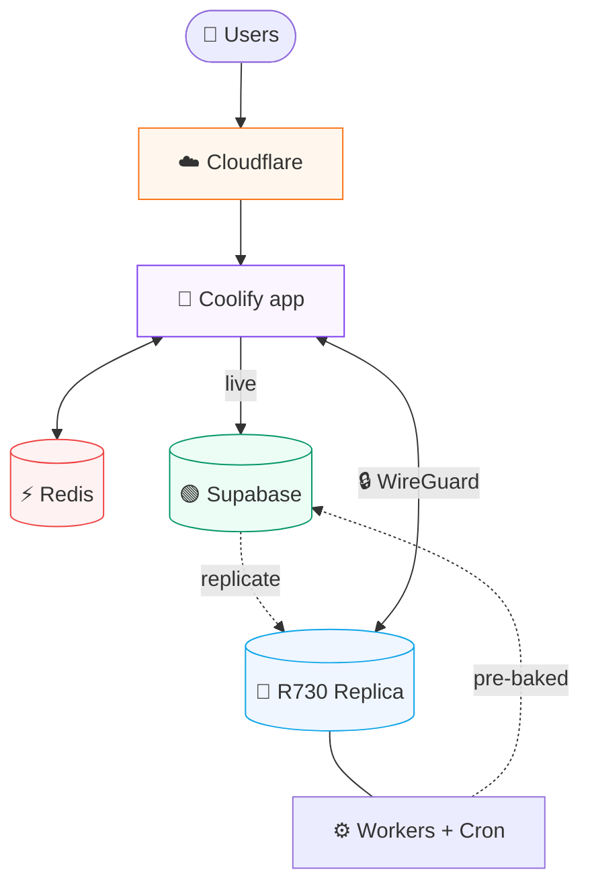
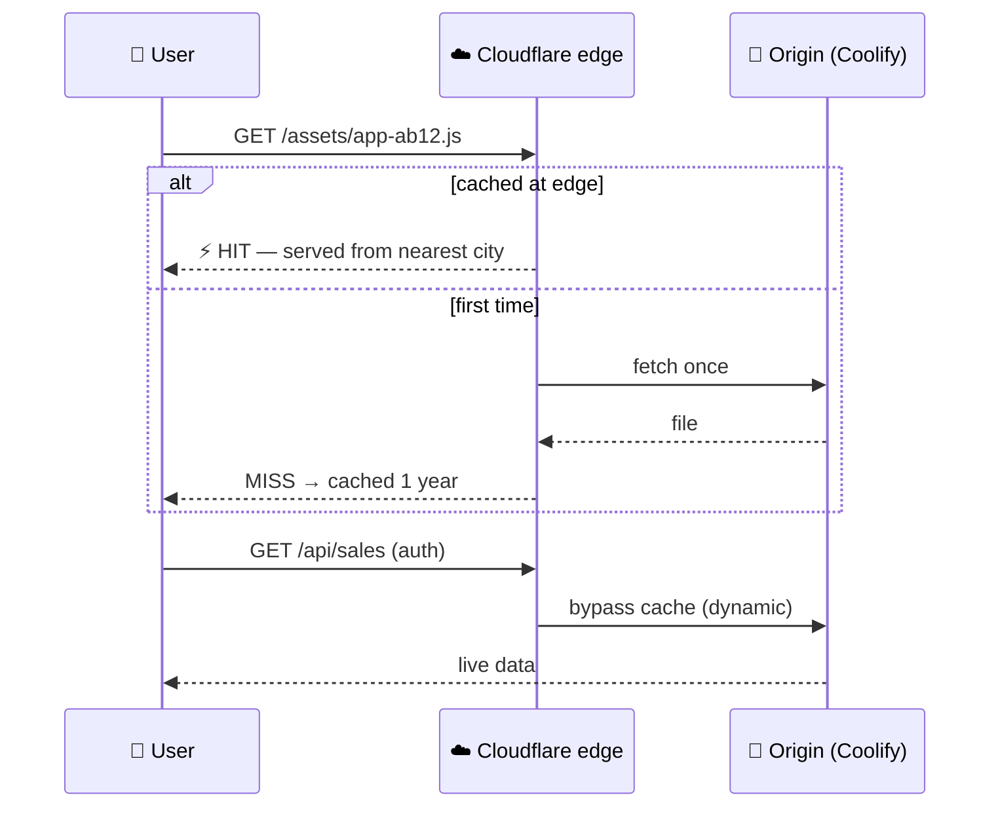
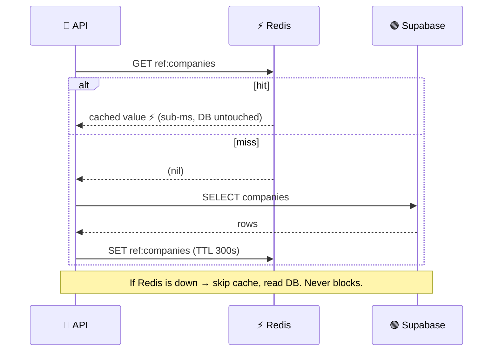
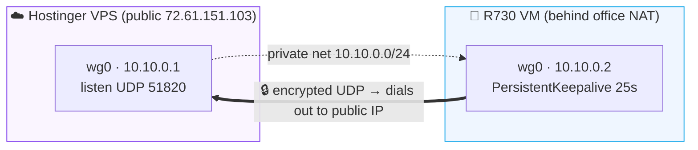
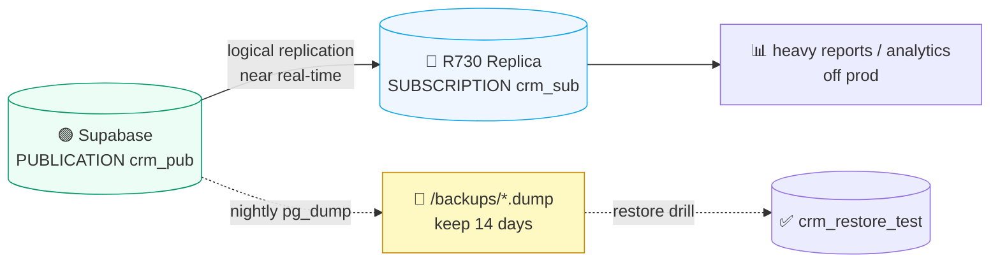
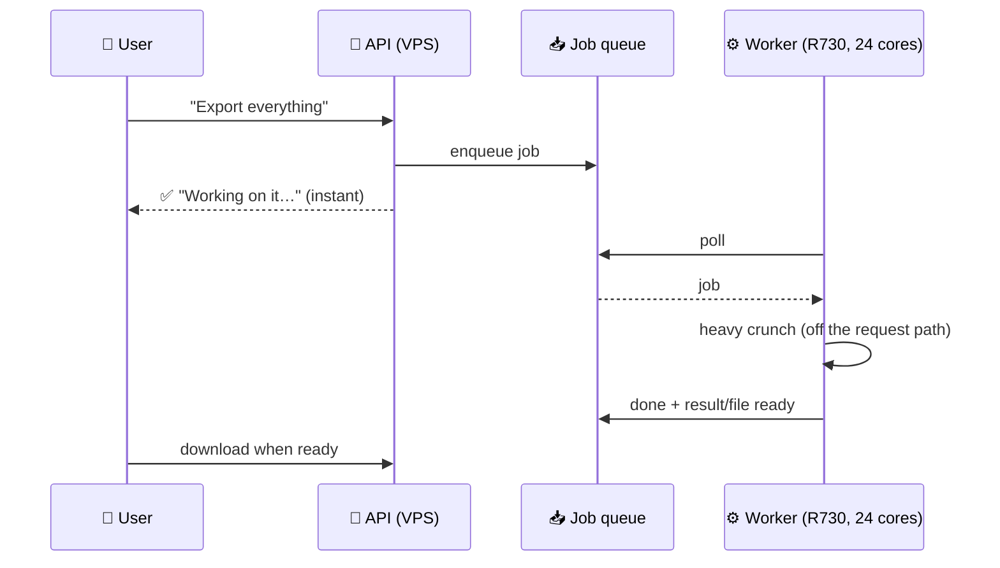
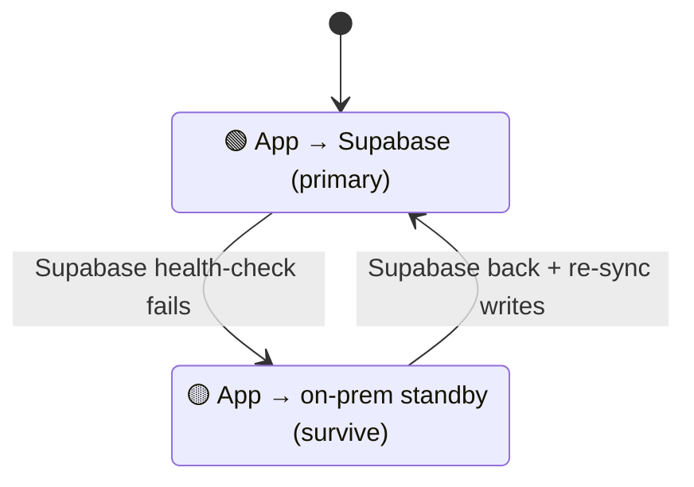
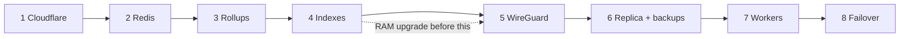

<div align="center">

# 🛠️ BizTrix CRM — Infrastructure Implementation Runbook

**The step-by-step "how to actually build it" guide.**
Companion to [`INFRASTRUCTURE.md`](./INFRASTRUCTURE.md) (the architecture).


</div>

> ⚠️ **Read first.** Do the phases **in order**. Each phase is a standalone win and is **reversible**. Never run two risky phases at once. Take a snapshot/backup before each on-prem change.

### 🧱 What we're building (end state)



---

## ✅ Phase 0 — Pre-flight (do once, before anything)

**Goal:** be able to undo anything.

1. **Supabase backup** — Dashboard → Database → Backups → confirm daily backups are on. Take a **manual backup** now.
2. **ESXi snapshots** — snapshot any VM you'll touch on the R730 (before creating/editing).
3. **Record current state** — note the live `SUPABASE_URL`, anon/service keys, and the Coolify env vars (you'll add to these, not replace).
4. **Pick a maintenance window** for the DNS cutover (Phase 1) — propagation can take minutes to hours.

**Checklist**
- [ ] Supabase manual backup taken
- [ ] Coolify env vars exported/saved
- [ ] Office static IP(s) written down (for allowlists)
- [ ] Hostinger VPS public IP confirmed: `72.61.151.103`

---

## ☁️ Phase 1 — Cloudflare (free) in front of the CRM

**Goal:** fast frontend, free SSL, DDoS protection, hidden origin IP.
**Touches:** GoDaddy DNS, Cloudflare. **No code, no server changes.**



### 1.1 Add the site
1. Create a free Cloudflare account → **Add a site** → `vertexpakistan.com`.
2. Cloudflare imports existing DNS — **verify** the record for the CRM exists:
   - `A  crm  → 72.61.151.103  (Proxied / orange cloud ON)`
3. Cloudflare shows **two nameservers** (e.g. `xxx.ns.cloudflare.com`).

### 1.2 Cut over nameservers at GoDaddy
1. GoDaddy → your domain → **Nameservers** → **Change** → **Custom** → paste Cloudflare's two NS.
2. Wait for Cloudflare to show **Active** (minutes–hours).

### 1.3 Fix SSL so the proxy doesn't break HTTPS
Cloudflare proxy + Coolify's own cert can clash. Pick **one**:
- **Recommended:** install a **Cloudflare Origin Certificate** on the Coolify proxy for `crm.vertexpakistan.com` (15-yr cert, no renewals), then set **SSL/TLS → Overview → Full (strict)**.
- **Or:** keep Coolify's Let's Encrypt cert and set **Full (strict)** (LE HTTP-01 still validates through the proxy).

> ❗ Do **not** use "Flexible" SSL — it causes redirect loops with an HTTPS origin.

### 1.4 Cache rules (Rules → Cache Rules)
| Order | Match | Action |
|---|---|---|
| 1 | `crm.vertexpakistan.com/api/*` | **Bypass cache** (never cache dynamic/auth) |
| 2 | `crm.vertexpakistan.com/assets/*` | **Cache Everything**, Edge TTL **1 year** (hashed = immutable) |
| 3 | `crm.vertexpakistan.com/` and `*/index.html` | **Cache Everything**, Edge TTL **2 min** (so deploys roll out) |

### 1.5 Speed toggles
Speed → Optimization: **Brotli ON**, **HTTP/3 ON**, **0-RTT ON**, **Early Hints ON**.

### 1.6 Lock down the Coolify dashboard
`manage.vertexpakistan.tech` controls deploys — protect it:
1. Add `vertexpakistan.tech` as a second Cloudflare zone (change its NS at Hostinger).
2. Either:
   - **Cloudflare Zero Trust → Access** → app for `manage.vertexpakistan.tech` → policy = allow only your emails, **or**
   - **WAF / IP Access Rule** → allow only your **office static IP(s)**, block the rest.
3. Ensure Coolify itself has a **strong password + 2FA**.

### 1.7 (Optional) Hide the origin fully
On the Hostinger VPS firewall, allow inbound **80/443 only from [Cloudflare IP ranges](https://www.cloudflare.com/ips/)**. Then nobody can reach the origin directly.

### ✔️ Verify Phase 1
```bash
dig crm.vertexpakistan.com +short          # should resolve to Cloudflare IPs, not 72.61.151.103
curl -sI https://crm.vertexpakistan.com/ | grep -i 'server\|cf-cache-status'
curl -sI https://crm.vertexpakistan.com/assets/<some-hashed-file>.js | grep -i cf-cache-status   # HIT after 2nd load
```
**Rollback:** revert GoDaddy nameservers to the originals.

---

## ⚡ Phase 2 — Redis cache on the Hostinger VPS

**Goal:** most hot reads skip Supabase → instant + much less DB load.
**Touches:** Coolify (new Redis service) + backend code. **Reversible** (cache is optional; app falls back to DB).



### 2.1 Stand up Redis (next to the app, private)
**Coolify:** Add Resource → **Redis** → same project/network as the backend → set a **strong password** → **don't** expose a public port.
Note the internal URL, e.g. `redis://default:<pass>@<service-name>:6379`.

### 2.2 Add the env var
Coolify → backend service → Environment:
```
REDIS_URL=redis://default:<pass>@<service-name>:6379
```

### 2.3 Backend cache helper
Install the client:
```bash
cd backend && npm i ioredis
```
Create `backend/utils/cache.js`:
```js
const Redis = require('ioredis');
const logger = require('./logger');

// Optional cache — if REDIS_URL is unset or Redis is down, everything still
// works (we just hit the DB). Never let the cache take the app down.
let redis = null;
if (process.env.REDIS_URL) {
  redis = new Redis(process.env.REDIS_URL, { maxRetriesPerRequest: 2, lazyConnect: false, enableOfflineQueue: false });
  redis.on('error', (e) => logger.warn('CACHE', `redis: ${e.message}`));
}

async function get(key) {
  if (!redis) return null;
  try { const v = await redis.get(key); return v ? JSON.parse(v) : null; } catch { return null; }
}
async function set(key, val, ttlSec) {
  if (!redis) return;
  try { await redis.set(key, JSON.stringify(val), 'EX', ttlSec); } catch { /* ignore */ }
}
async function del(...keys) {
  if (!redis || !keys.length) return;
  try { await redis.del(...keys); } catch { /* ignore */ }
}
// cached(key, ttl, loader): return cache hit, else load + store.
async function cached(key, ttlSec, loader) {
  const hit = await get(key);
  if (hit !== null) return hit;
  const fresh = await loader();
  if (fresh !== undefined && fresh !== null) await set(key, fresh, ttlSec);
  return fresh;
}
module.exports = { get, set, del, cached, redis };
```

### 2.4 Wrap the hot reads (start with the safest, rarely-changing ones)
Good first candidates (high read volume, low change rate):
- Feature flags, `businessConfig` (already in-memory; Redis makes it consistent across instances)
- Role permissions, reference data (companies, closers, form fields)
- Dashboard / KPI rollups (after Phase 3)

Pattern:
```js
const cache = require('../utils/cache');
const companies = await cache.cached('ref:companies', 300, async () => {
  const { data } = await supabaseAdmin.from('companies').select('id,name');
  return data || [];
});
```

### 2.5 Invalidate on write
Wherever the cached data is **changed**, drop the key:
```js
await supabaseAdmin.from('companies').update(...).eq('id', id);
await cache.del('ref:companies');
```
> Rule of thumb: short TTL (60–300s) for "mostly static" data needs little manual invalidation; add explicit `del()` only where staleness matters (permissions, flags).

### ✔️ Verify Phase 2
```bash
# inside the redis container / via coolify exec
redis-cli -a <pass> INFO stats | grep keyspace_hits
redis-cli -a <pass> KEYS 'ref:*'
```
Watch API response times drop on the cached endpoints.
**Rollback:** remove `REDIS_URL` → app runs straight off the DB.

---

## 📊 Phase 3 — Precomputed rollups (dashboards stop doing math live)

**Goal:** KPIs/dashboards become single-row reads instead of live aggregations.
**Touches:** Supabase (a summary table + `pg_cron`), backend read path.

```mermaid
flowchart LR
    CR[⏰ pg_cron<br/>every 15 min] --> FN[refresh_dashboard_metrics&#40;&#41;]
    FN -->|COUNT/SUM once| T[(📊 dashboard_metrics<br/>tiny summary table)]
    APP[🚀 Dashboard] -->|1-row read| T
    style T fill:#d1fae5,stroke:#059669
    style CR fill:#fef9c3,stroke:#ca8a04
```



### 3.1 Summary table
```sql
create table if not exists dashboard_metrics (
  scope        text not null,          -- e.g. 'company:<uuid>' or 'global'
  metric       text not null,          -- e.g. 'sales_today', 'sales_mtd'
  value        numeric not null default 0,
  computed_at  timestamptz not null default now(),
  primary key (scope, metric)
);
```

### 3.2 Compute function
```sql
create or replace function refresh_dashboard_metrics() returns void language plpgsql as $$
begin
  insert into dashboard_metrics (scope, metric, value, computed_at)
  select 'company:'||company_id, 'sales_mtd', count(*), now()
  from sales
  where sale_date >= date_trunc('month', now())::date
  group by company_id
  on conflict (scope, metric) do update
    set value = excluded.value, computed_at = excluded.computed_at;
  -- add more metrics here…
end $$;
```

### 3.3 Schedule it (Supabase `pg_cron`)
Dashboard → Database → Extensions → enable **`pg_cron`**, then:
```sql
select cron.schedule('dash-rollup', '*/15 * * * *', $$ select refresh_dashboard_metrics(); $$);
```

### 3.4 Read it (backend)
Dashboards read `dashboard_metrics` (one indexed row each) instead of aggregating `sales`. Cache the read in Redis too (Phase 2).

### ✔️ Verify
```sql
select * from dashboard_metrics order by computed_at desc limit 10;
select * from cron.job;            -- the schedule exists
```
**Rollback:** `select cron.unschedule('dash-rollup');` and point the app back at the live query.

---

## 🔎 Phase 4 — Hot-path indexes

**Goal:** the live queries that remain are fast.
**Touches:** Supabase only. Use `CONCURRENTLY` so it never locks the table.

1. Find slow queries: Supabase → Reports / `pg_stat_statements` (enable the extension).
2. Add covering indexes for the hot filters, e.g.:
```sql
create index concurrently if not exists idx_sales_company_saledate on sales (company_id, sale_date desc);
create index concurrently if not exists idx_sales_closer_saledate  on sales (closer_id, sale_date desc);
create index concurrently if not exists idx_sales_client_name       on sales (client_name);
create index concurrently if not exists idx_transfers_closer        on transfers (assigned_closer_id);
```
3. Confirm with `EXPLAIN ANALYZE` (look for *Index Scan*, not *Seq Scan*).

> Keep migrations in `backend/migrations/` (next free number) so they're tracked.

---

## 🔒 Phase 5 — WireGuard tunnel (Hostinger ⇄ R730)

**Goal:** a private encrypted link so the on-prem box joins the cloud — no public Postgres.
**Touches:** the Hostinger VPS + a new Linux VM on the R730.



### 5.1 Create the on-prem VM (ESXi)
- New VM: **Ubuntu Server 22.04 LTS**, 4 vCPU, **8–16 GB RAM** (after your RAM upgrade), disk on the **`ssd2`** datastore.
- Update + install: `sudo apt update && sudo apt install -y wireguard postgresql-client`.

### 5.2 Keys (on BOTH boxes)
```bash
wg genkey | tee privatekey | wg pubkey > publickey
```

### 5.3 VPS = WireGuard server (`/etc/wireguard/wg0.conf`)
```ini
[Interface]
Address = 10.10.0.1/24
ListenPort = 51820
PrivateKey = <VPS_PRIVATE_KEY>

[Peer]                       # the R730 VM
PublicKey = <R730_PUBLIC_KEY>
AllowedIPs = 10.10.0.2/32
```

### 5.4 R730 VM = WireGuard client (`/etc/wireguard/wg0.conf`)
```ini
[Interface]
Address = 10.10.0.2/24
PrivateKey = <R730_PRIVATE_KEY>

[Peer]                       # the Hostinger VPS (public)
PublicKey = <VPS_PUBLIC_KEY>
Endpoint = 72.61.151.103:51820
AllowedIPs = 10.10.0.0/24
PersistentKeepalive = 25     # holds the tunnel open through office NAT
```

### 5.5 Open the port + bring it up
- VPS firewall: allow **UDP 51820** (Cloudflare doesn't proxy UDP — this is direct to the VPS IP).
```bash
sudo systemctl enable --now wg-quick@wg0     # run on BOTH
```

### ✔️ Verify
```bash
sudo wg show                    # handshake + transfer counters increasing
ping 10.10.0.1                  # from the R730 VM
ping 10.10.0.2                  # from the VPS
```
**Rollback:** `sudo systemctl disable --now wg-quick@wg0`.

---

## 📀 Phase 6 — On-prem Postgres replica + backups

**Goal:** an owned, recoverable copy + an analytics/heavy-read offload.
**Touches:** the R730 VM (Postgres) + Supabase (publication).



### 6.1 Install Postgres on the R730 VM
Match Supabase's **major version** (check Supabase → Settings → Infrastructure, usually 15):
```bash
sudo apt install -y postgresql-15
```

### 6.2 Get Supabase's DIRECT connection (NOT the pooler)
Supabase → Settings → Database → Connection string → **Direct connection** (`db.<ref>.supabase.co:5432`). Logical replication does **not** work through the `:6543` pooler.

### 6.3 Copy the schema first
```bash
# from the R730 VM, over the tunnel-independent public DB (one-time)
pg_dump --schema-only --no-owner --no-privileges \
  "postgresql://postgres:<DB_PW>@db.<ref>.supabase.co:5432/postgres" \
  | psql "postgresql://localhost/crm_replica"
```

### 6.4 Publication (on Supabase) + subscription (on the replica)
On Supabase (SQL editor) — publish the **business tables** (the `public` schema is the safe, useful set; replicating `auth`/`storage` has ownership caveats — do those via the nightly dump in 6.6):
```sql
create publication crm_pub for tables in schema public;
```
On the replica:
```sql
create subscription crm_sub
  connection 'postgresql://postgres:<DB_PW>@db.<ref>.supabase.co:5432/postgres'
  publication crm_pub;
```

### 6.5 Watch replication
```sql
-- on the replica
select subname, received_lsn, latest_end_lsn from pg_stat_subscription;
```

> ⚠️ **Caveats:** logical replication copies **data, not DDL** — when you run a CRM migration, apply the schema change to **both** Supabase and the replica. Sequences and new tables added to the publication need a `alter subscription crm_sub refresh publication;`.

### 6.6 Nightly full backup (belt + suspenders)
On the R730 VM, `/opt/crm/backup.sh`:
```bash
#!/usr/bin/env bash
set -euo pipefail
TS=$(date +%F_%H%M)
OUT=/backups/crm_${TS}.dump
pg_dump -Fc --no-owner --no-privileges \
  "postgresql://postgres:<DB_PW>@db.<ref>.supabase.co:5432/postgres" -f "$OUT"
# keep 14 days
find /backups -name 'crm_*.dump' -mtime +14 -delete
```
Cron:
```bash
chmod +x /opt/crm/backup.sh
( crontab -l 2>/dev/null; echo "30 2 * * * /opt/crm/backup.sh >> /var/log/crm-backup.log 2>&1" ) | crontab -
```

### 6.7 Restore DRILL (do it once — an untested backup isn't a backup)
```bash
createdb crm_restore_test
pg_restore --no-owner -d crm_restore_test /backups/crm_<latest>.dump
psql -d crm_restore_test -c "select count(*) from sales;"
dropdb crm_restore_test
```

---

## ⚙️ Phase 7 — Background workers on the R730

**Goal:** move slow jobs (exports, recording pre-scan, backfills, fan-out) off the user request path onto the idle 24 cores.
**Touches:** a worker process on the R730 VM + a job queue.



### 7.1 Queue
Reuse Redis (BullMQ) — but the queue must be reachable by **both** the VPS app and the R730 worker. Options:
- Put a **second Redis** on the R730 VM for the queue (workers local, app reaches it over the tunnel `10.10.0.2:6379`), **or**
- Use a **DB-backed job table** (simplest, no extra infra): app inserts a `jobs` row; the worker polls.

### 7.2 Worker (Node) on the R730 VM
- Clone the backend repo (or a slim worker package) onto the VM.
- It connects to: Supabase (jobs/results), the **replica** (heavy reads), and the **dialer** for recording scans.
- ❗ If the worker does recording scans, the **R730's public IP must also be whitelisted on the dialer** (same `:81` IP Validation Portal flow as the VPS).

### 7.3 First job to move: recording availability pre-scan
- A nightly worker runs `findSaleRecording` per recent sale → writes a `has_recording` flag (new column or a `sale_recording_cache` table).
- The portal then filters to sales-with-recordings **instantly** (no live dialer calls) — the feature we deferred.

### 7.4 Run it as a service
```bash
# /etc/systemd/system/crm-worker.service  → ExecStart=node worker.js
sudo systemctl enable --now crm-worker
```

---

## 🚀 Phase 8 — (Later) Self-hosted Supabase + failover

**Goal:** a full hot standby + the ability to switch if Supabase is down.



1. **Self-hosted Supabase stack** on the R730 (the official `docker-compose`), pointed at the replica DB.
2. **Same `JWT_SECRET`** as the managed project → existing logins stay valid on either side.
3. **Switch (v1, manual):** change the backend's `SUPABASE_URL`/keys in Coolify → redeploy (~minutes). Document it as a runbook.
4. **Switch (v2, auto):** front the DB/API with your domain → a health-checking **proxy** (HAProxy/Traefik) flips to the standby when Supabase fails.
5. **Failback plan:** when Supabase returns, re-sync writes that happened during the outage *before* switching back.

> Don't attempt auto-failover until the replica + backups (Phase 6) are proven and a restore drill has passed.

---

## 🧭 Order of operations (quick view)



| Phase | On-prem needed? | Reversible? | Main risk |
|---|---|---|---|
| 1 Cloudflare | No | Yes (revert NS) | DNS cutover window |
| 2 Redis | No | Yes (remove env) | Stale cache → use TTLs + invalidation |
| 3 Rollups | No | Yes (unschedule) | Wrong aggregation → verify counts |
| 4 Indexes | No | Yes (drop index) | None (use CONCURRENTLY) |
| 5 WireGuard | Yes | Yes (disable) | Firewall/port |
| 6 Replica | Yes | Yes (drop sub) | Schema drift (apply DDL to both) |
| 7 Workers | Yes | Yes (stop svc) | Dialer IP whitelist for scans |
| 8 Failover | Yes | Yes | Failback/data-loss window |

---

## 🔑 Secrets & access checklist (gather before starting)
- [ ] Cloudflare account
- [ ] GoDaddy login (nameserver change) + Hostinger DNS (for `.tech`)
- [ ] Supabase **DB password** + **direct connection string**
- [ ] Coolify admin (env vars, add Redis)
- [ ] ESXi root + a new Ubuntu VM
- [ ] Office static IP(s) (for allowlists)
- [ ] Dialer `:81` creds (if workers do recording scans)

---

<div align="center">

*Build in order. Verify each phase. Keep a backup. — BizTrix Ventures*

</div>
